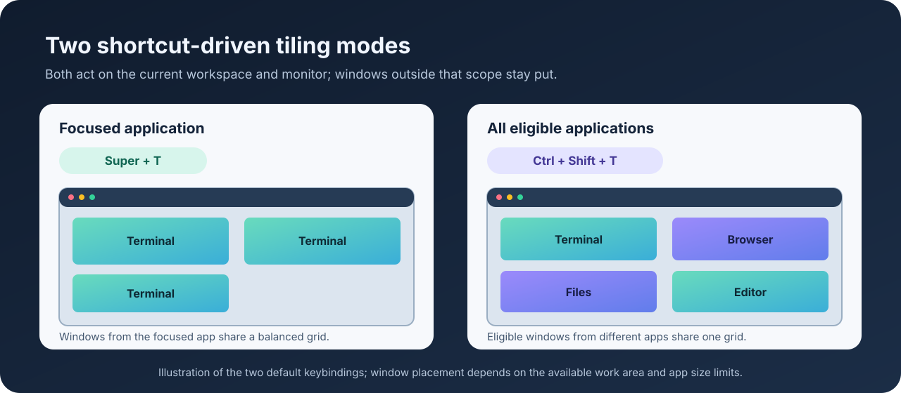

> Part of [mt_stack](https://github.com/mikaeltorni/mt_stack), a Linux setup stack of independently installable projects.

# Linux Automatic Window Tiling for GNOME Shell

[](https://github.com/mikaeltorni/linux_automatic_window_tiling/commits/master)
[](https://github.com/mikaeltorni/linux_automatic_window_tiling/graphs/commit-activity)
[](https://github.com/mikaeltorni/linux_automatic_window_tiling/issues)

Linux Automatic Window Tiling is a GNOME Shell extension for shortcut-driven tiling of same-application windows or all eligible windows.

By default, `Super+T` tiles windows from the focused app and `Ctrl+Shift+T` tiles all eligible windows on the current workspace and monitor. A keybinding or D-Bus request starts tiling; opening a window by itself does not reflow the layout.

[Quick start](#quick-start) · [Features](#features-of-gnome-shell-window-tiling) · [Dependencies](#repository-dependencies) · [Installation](#install-the-gnome-shell-window-tiling-extension) · [Configuration](#configure-gnome-shell-window-tiling) · [Development](#developing-the-gnome-shell-window-tiling-extension) · [Contributing](#contributing) · [Integration](#integrating-gnome-shell-window-tiling) · [FAQ](#gnome-shell-window-tiling-faq) · [License](#license)

## Quick start

From this checkout, install the extension without the private shared installer framework:

```bash
bash install.sh --standalone
```

Focus an app window and press `Super+T` to tile that app's windows. Press `Ctrl+Shift+T` to tile every eligible window on the same workspace and monitor.



## Repository dependencies

The standalone command above installs directly from this checkout. It does not fetch setup repositories or require GitHub credentials. It needs the build and desktop tools listed below; obtaining a toolchain or container image can require network access.

The optional [installation_scripts](https://github.com/mikaeltorni/installation_scripts) bundle clones and runs this installer
as its own selectable repository; `linux_hotkey_setup` does not configure it.
Bundle/menu modes (commands without `--standalone`) use
[`linux_installation_scripts_functions`](https://github.com/mikaeltorni/linux_installation_scripts_functions), resolving a sibling checkout or cloning
it using the current Git credentials. That framework is currently private;
use `--standalone` to install from this checkout without framework access.

See the full cross-repository map in
[installation_scripts/DEPENDENCIES.md](https://github.com/mikaeltorni/installation_scripts/blob/master/DEPENDENCIES.md).

## Features of GNOME Shell Window Tiling

- Only normal, taskbar-visible windows are tiled.
- Windows must match the focused application's tile group: exact identity for
  most apps, with plain `kitty` and per-provider `kitty-agent-*` model-icon
  terminals co-tiling as one family (icons stay distinct via real WM_CLASS).
- Windows must already be on the focused window's workspace and monitor.
- Maximized matching windows remain eligible: Super+T restores them before
  placing them in the grid, including when the focused window is maximized.
  Windows outside the selected application, workspace, or monitor keep their state.
- Ctrl+Shift+T includes every eligible application on the focused window's
  workspace and monitor, using one balanced grid for the mixed window set.
- One window fills the monitor work area.
- Two windows tile left/right when their minimum widths fit.
- Four windows start with a 2x2 grid.
- On a portrait (taller-than-wide) monitor, windows stack top-to-bottom in a single full-width column (two windows are top and bottom, a third continues below and is never cut in half); a configurable minimum tile height keeps a window usable before the next one wraps into a column to the right.
- Other counts use a balanced calculated grid.
- Application minimum sizes can force a less dense grid. For example, three
  GNOME Terminal windows on a small VM display use a 2x2 grid when three
  columns would overlap. Character-cell resize increments can leave small gaps.
  If no uniform grid can fit the application minimum sizes, the original
  window positions, sizes, and maximized/fullscreen/minimized states are restored.
  The journal explains why the request could not fit.
- Kitty uses a 1300px preferred width to choose grid density on wide monitors,
  and windows are requested to fill their complete cells subject to application
  size constraints.
- GNOME's work area is used, excluding panels and docks.
- Pressing the accelerator again while the windows already fill the grid rotates
  them by one cell instead of re-tiling them into the same places, so tapping
  the combination repeatedly cycles through the possible arrangements.

## Install the GNOME Shell Window Tiling Extension

### Standalone GNOME Shell installation

From the repository directory, install as the desktop user without sudo:

```bash
bash install.sh --standalone
```

Select both shortcuts independently during installation:

```bash
bash install.sh --standalone --binding '<Super>t' --all-binding '<Super><Shift>t'
```

Standalone mode deploys the complete extension and configures both shortcuts,
application widths, and portrait wrapping. It accepts the existing `AWT_*`
environment overrides below, and `--default` / `--all` are optional aliases for
that complete installation. On a terminal, omitted shortcuts can be typed at
the prompts; non-interactive runs use defaults or supplied values.
Use `bash install.sh --standalone --help` for usage.

### Bundle and component-menu installation

With access to the shared framework, omit `--standalone` to use its component
menu and selection/configuration controls. The core is installed when applying
a selection, including an empty selection; queries and uninstall never deploy
or enable the extension. The legacy positional accelerator installs defaults:

```bash
bash install.sh '<Super>t'
bash install.sh --binding '<Control><Alt>t'
bash install.sh --binding '<Super>t' --all-binding '<Super><Shift>t'
```

The equivalent `--binding=<accelerator>` and
`--all-binding=<accelerator>` forms are also accepted. The legacy positional
accelerator remains an alias for `--binding`.

The same choices work in scripted standalone or bundle installs through
environment overrides:

```bash
AWT_BINDING='<Super>t' AWT_ALL_BINDING='<Super><Shift>t' bash install.sh --default
```

For press-to-capture on a terminal, enable the shared capture UI for this
component install through the shared framework:

```bash
ISC_HOTKEY_INTERACTIVE=1 bash install.sh --select keybinding
```

The master bundle passes `AWT_BINDING` / `AWT_ALL_BINDING` overrides through to
this installer. Explicit values bypass interactive capture.

Component-framework flags select exactly what to configure:

```bash
bash install.sh                      # interactive component menu on a TTY
bash install.sh --default            # all default-on components, no prompts
bash install.sh --all                # every component, no prompts
bash install.sh --select keybinding  # only the listed component ids
bash install.sh --list-components    # id<TAB>label<TAB>default, for tooling
bash install.sh --export-selection   # export current component selection
bash install.sh --help              # print installer help
```

`--select`, `--reconfigure`, `--uninstall`, `--config`, and
`--configure-component` also accept `--option=value` syntax. Framework controls
are intentionally separate from `--standalone`; combining them is rejected
before changing the desktop.

Advanced framework queries include `--list-configurable-components`,
`--list-select-configure-components`, and `--list-component-config-values`.
`--configure-component ID` opens a component's registered configuration screen
when one exists; this repository currently exposes its tunings through the
environment and shortcut capture. Use `--config NAME.json` to select an
`installation_configs/` profile, `--export-selection` to export its selection,
and `--auth` to enable the framework's authentication option.

## Configure GNOME Shell Window Tiling

### Available components

All components are default-on, so a plain install reproduces the extension's
built-in behavior. Each writes a single gsettings key, so behavior stays fully
customizable without editing the extension source:

| Component | gsettings key | Env override | Default |
| --- | --- | --- | --- |
| `keybinding` | `tile-focused-application-windows`, `tile-all-windows` | `AWT_BINDING`, `AWT_ALL_BINDING` | `<Super>t`, `<Control><Shift>t` |
| `per_app_widths` | `application-preferred-widths` | `AWT_APP_WIDTHS` | `kitty:1300` |
| `portrait_stacking` | `portrait-minimum-tile-height` | `AWT_PORTRAIT_MIN_HEIGHT` | `0` |

`AWT_ALL_BINDING` changes the monitor-wide all-window accelerator while keeping
Ctrl+Shift+T as the default. `AWT_APP_WIDTHS` is a comma- or space-separated list
of `name:width` entries.
A `portrait-minimum-tile-height` of `0` (the default) keeps portrait monitors in a
single, full-height column (pure vertical stacking, top to bottom). Set a positive
value (for example `1080`) to wrap windows into side-by-side columns once a column
would fall below that height, keeping many windows usable on a tall monitor. On a TTY the `keybinding`
component uses the shared press-to-capture engine for both keys when
`ISC_HOTKEY_INTERACTIVE=1`; otherwise it uses the configured values or defaults.

The installer can run directly as the desktop user or through `sudo`. When run
through `sudo`, it builds using the `SUDO_USER` toolchain, installs into that
user's local GNOME Shell extension directory, and applies settings through
the user's session bus. It
requires `glib-compile-schemas` (Ubuntu package `libglib2.0-bin`) and builds the
`awt-tools` Rust helper during installation. Provide a current stable Rust/Cargo
toolchain and a C linker (Ubuntu package `build-essential`), or Docker/Podman
for the container build fallback. Ubuntu 24.04's
distribution Cargo 1.75 cannot read the checked-in lockfile; use a current
toolchain through rustup instead. When the shared framework is not checked out as a
sibling, bundle/menu modes require Git credentials for
`linux_installation_scripts_functions`; `--standalone` bypasses it entirely.

GSettings accelerator changes apply live. If edited extension JavaScript needs
a Shell reload, install the automation tool if missing and use GNOME's in-place
run-dialog reload on X11:

```bash
command -v xdotool || sudo apt install -y xdotool
xdotool key --clearmodifiers alt+F2
sleep 0.5
xdotool type 'r'
xdotool key Return
```

On Wayland, deploy the files and log out and back in to load edited extension
code.

## Developing the GNOME Shell Window Tiling Extension

Runtime modules:

- `extension.js` owns keybinding/D-Bus registration and lifecycle teardown.
- `tiling.js` owns instance settings, focused/all/background placement, cycling,
  and rollback when a grid cannot fit.
- `preferences.js` parses settings and validates effective application widths.
- `layout.js` owns pure grid selection and tile geometry calculations.
- `windows.js` owns GNOME window selection, identity, state management, and final
  frame placement after resizing.

Run the complete local test and build checks:

```bash
./tests/run_tests.sh
```

The runner checks Rust tests and builds, Python tests, Bash syntax, and the
GSettings schema. It requires Cargo, Python with pytest, Node.js, and
`glib-compile-schemas`.

The individual checks can also be run separately:

```bash
cargo test
python3 -m pytest tests -q
bash -n install.sh
glib-compile-schemas --strict schemas
```

The compiled `schemas/gschemas.compiled` file is generated and ignored.

The installer helper has no external Cargo dependencies. Build it independently
with `bash scripts/build_awt_tools.sh`; `--print` prints the resulting binary
path, and `--help` prints build usage. Its public CLI appends one value to
`CURRENT`, preserving existing entries and removing duplicates:

```bash
CURRENT="@as ['existing@local']" dist/awt-tools automatic-window-tiling@local
# ['existing@local', 'automatic-window-tiling@local']
```

Exactly one positional value is required; malformed existing array text is
treated as empty for compatibility. Diagnostics remain separate from its
machine-readable stdout.

### GNOME Shell verification scope

The release checks passed 8 Rust and 101 Python tests, helper builds, shell
syntax, and strict GSettings schema validation. They include public installer
commands in isolated homes, clean installation/reinstallation, failed builds,
invalid commands, target-user sudo builds, both shortcut callbacks, D-Bus
grouping/teardown, and live settings changes.

Actual installation and geometry/cycling were checked on Ubuntu 24.04.5 LTS,
GNOME 46, X11, including independent standalone and clean sudo installations.
GNOME 45–50 are listed as compatible; newer Mutter maximization signatures
have mocked regression coverage. Other GNOME versions and Wayland have not
received the same live VM verification. Application minimum sizes can make a
uniform grid impossible; such requests restore the previous layout.

### Live X11 window-tiling verification

`tests/check_vm_tiling.py` checks actual GTK window frames after pressing a
configured shortcut twice. It verifies that windows fit the work area without
overlap and that a second press rotates their positions. It moves the selected
windows, so use a dedicated test workspace with at least two GNOME Terminal
windows on the same monitor. For the all-window shortcut, include every eligible
window in that workspace. The checker requires Python 3, `xdotool`, `xprop`,
and `xwininfo` (the latter two are in Ubuntu's `x11-utils` package).

Run inside the VM's X11 desktop, or an SSH shell using that desktop's display,
X authority, runtime directory, and session bus. Use the installed bindings for
`--key`; these examples use the defaults (`super+y` is valid for a customized
Super+Y binding):

```bash
mapfile -t window_ids < <(xdotool search --onlyvisible --desktop "$(xdotool get_desktop)" --class Gnome-terminal)
python3 tests/check_vm_tiling.py --key super+t --windows "${window_ids[@]}"
python3 tests/check_vm_tiling.py --key ctrl+shift+t --windows "${window_ids[@]}"
```

For a window set known to exceed the available grid capacity, add
`--expect-unchanged`. This checks that two repeated requests preserve the
original geometry instead of leaving partially placed windows off-screen.
Pass every eligible window ID, including other applications for the all-window
shortcut. Replace the `ID1` placeholders with numeric X11 window IDs:

```bash
python3 tests/check_vm_tiling.py --expect-unchanged --key ctrl+shift+t --windows ID1 ID2 ID3 ID4
```

## Contributing

This is a private repository, so contribution access is limited to authorized collaborators. Before changing installed behavior, read [AGENTS.md](AGENTS.md) and follow the development and verification steps in this README.

## Integrating GNOME Shell Window Tiling

The `installation_scripts` master installer clones this repository and runs it
directly before `linux_hotkey_setup`. It exposes this installer's
`keybinding` component in the repository selection menu. Configure both hotkeys
for the bundle with:

```bash
sudo env AWT_BINDING='<Super>t' AWT_ALL_BINDING='<Super><Shift>t' bash install.sh
```

The same accelerator options are available without the bundle through
`bash install.sh --standalone`.

The background D-Bus interface retains both public entrypoints:

```bash
gdbus call --session --dest org.gnome.shell.extensions.AutomaticWindowTiling \
  --object-path /org/gnome/shell/extensions/automatic_window_tiling \
  --method org.gnome.shell.extensions.AutomaticWindowTiling.TileWindowGroup '0x123456'
gdbus call --session --dest org.gnome.shell.extensions.AutomaticWindowTiling \
  --object-path /org/gnome/shell/extensions/automatic_window_tiling \
  --method org.gnome.shell.extensions.AutomaticWindowTiling.TileWindowGroups "['0x123456', '0x234567']"
```

Replace example IDs with actual X11 window IDs. Invalid or unavailable IDs are
ignored; background calls preserve focus/workspace and do not cycle layouts.

## Reconfiguring and uninstalling the window-tiling extension

Framework modes track component configuration and support reapplying or
resetting it:

```bash
bash install.sh --detect            # show each component as installed|absent
bash install.sh --reconfigure a,b   # re-apply (idempotent) these component ids
bash install.sh --uninstall a,b     # uninstall these component ids
```

Component uninstall resets its settings to schema defaults; it does not remove
the mandatory extension core. This applies only to the framework/menu path.
To disable or remove the user extension itself, including a standalone install:

```bash
gnome-extensions disable automatic-window-tiling@local
gnome-extensions uninstall automatic-window-tiling@local
```

In the interactive menu (run `bash install.sh` on a terminal, or via the master
installer), already-installed components show a green `✓`. Select one with
**space** to **reconfigure** it (`~`), press **`u`** to mark it for **uninstall**
(`✗`), or press **`r`** to reconfigure every installed component at once. Detection
uses a live check where deterministic and otherwise an install receipt under
`${XDG_STATE_HOME:-~/.local/state}/isc/receipts/`; a component without a reversal
step simply clears that receipt on uninstall.

## GNOME Shell Window Tiling FAQ

### What does `Super+T` tile?

`Super+T` arranges normal, taskbar-visible windows from the focused application's tile group on the current workspace and monitor. Plain `kitty` and `kitty-agent-*` terminal windows can share one group; other application identities remain separate.

### How do I tile every eligible application window?

Press `Ctrl+Shift+T` to arrange all eligible windows on the focused window's workspace and monitor. Applications outside that workspace or monitor keep their current layout.

### Does the extension tile when an application opens?

No. Tiling starts when a configured shortcut or the extension's D-Bus method is called, so opening a window does not trigger reflow by itself.

### Why can a tiling request leave the original layout unchanged?

An application can refuse a tile that is smaller than its minimum size. If no uniform grid fits every selected window, the extension restores their previous positions, sizes, and maximized, fullscreen, or minimized states.

### How does window tiling work on a portrait monitor?

The default setting stacks windows top to bottom in one full-height column. A positive `portrait-minimum-tile-height` wraps additional windows into another column when the current column would become too short.

### Can a desktop launcher tile windows in the background?

Yes. The `TileWindowGroup` and `TileWindowGroups` D-Bus methods accept X11 window IDs and place groups without changing focus or cycling the current layout.

## Disclaimer and safety

This software is provided under the MIT License on an **“as is”** basis, without warranties of any kind. To the maximum extent permitted by applicable law, the authors and copyright holders shall not be liable for any claims, damages, losses, or other liability arising from the use of this software.

You are solely responsible for determining whether this software is suitable, safe, lawful, and appropriate for your intended use. Unless explicitly stated otherwise, this project is general-purpose software and is not designed, tested, certified, or approved for safety-critical, medical, automotive, aviation, industrial-control, life-support, cybersecurity-critical, financial-critical, or other high-risk use cases.

The authors and copyright holders make no guarantees regarding security, reliability, availability, correctness, compliance, non-infringement, or fitness for any particular purpose.

This notice is intended to clarify the nature of the project and does not impose additional restrictions beyond the MIT License.

## License

This project is licensed under the MIT License. See [LICENSE.md](LICENSE.md) for the full terms.

## Independent public setup entrypoint

This project's root `install.sh` is also used by the public `mt_stack` hub from
a separate checkout. The installer carries its required MIT menu/runtime support
in `.installer-support/`, so a standalone install needs no private framework
repository, private credentials, populated framework cache or hub checkout.
Keep that directory with the source when installing from an archive.

```bash
bash install.sh --list-components
bash install.sh --export-selection
bash install.sh
```

The existing component interface and options documented above remain available;
`ISC_FUNCTIONS_DIR` is an explicit support override. Run
`python3 tests/check_standalone_public.py` to check discovery and selection JSON
with downloads blocked. Runtime extension source is unchanged by this installer
support migration. These owner fixes are committed locally and must be explicitly
published before a fresh public clone can use them.
